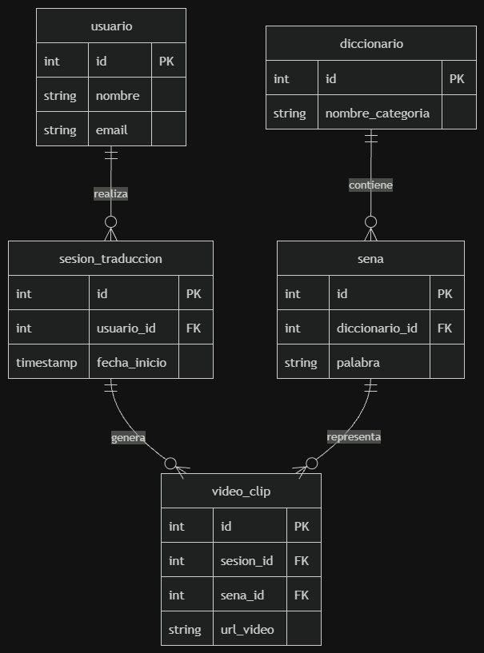

# Documentación P1 — Base de Datos y Mapeo de Requerimientos

## 1. Diagrama Entidad-Relación (ERD)
El diagrama ERD del sistema define la estructura de datos requerida para gestionar usuarios, sus sesiones de traducción y el catálogo de señas.

---

## 2. Navegación y Rutas del Sistema

| Ruta / URL | Descripción | Consulta SQL Principal |
| :--- | :--- | :--- |
| `/traduccion/iniciar` | Crear una sesión de traducción | `INSERT INTO sesion_traduccion (usuario_id, fecha_inicio) VALUES (?, NOW());` |
| `/diccionario` | Obtener catálogo de señas activas | `SELECT * FROM sena WHERE activo = TRUE;` |
| `/historial` | Consultar sesiones de un usuario | `SELECT * FROM sesion_traduccion WHERE usuario_id = ? ORDER BY fecha_inicio DESC;` |
| `/sesion/:id` | Obtener el detalle y videos de una sesión | `SELECT * FROM video_clip WHERE sesion_id = ?;` |

---

## 3. Metadatos e Índices de Rendimiento

### Índices Creados
* `idx_sena_categoria`: Optimiza las búsquedas de señas filtradas por categoría en la tabla `sena`.
* `idx_sesion_fecha`: Acelera la carga del historial de sesiones filtradas por fecha en `sesion_traduccion`.
* `idx_usuario_email`: Agiliza la búsqueda durante el inicio de sesión del usuario en la tabla `usuario`.

### Taxonomías / Categorías del Diccionario
Las señas se organizan bajo las siguientes categorías predefinidas:
1. **Saludos y Cortesía** (ej: *Hola, Gracias, Adiós*)
2. **Emergencias y Salud** (ej: *Ayuda, Dolor, Doctor*)
3. **Escuela y Aprendizaje** (ej: *Profesor, Libro, Clase*)
4. **Vida Cotidiana** (ej: *Comida, Agua, Casa*)